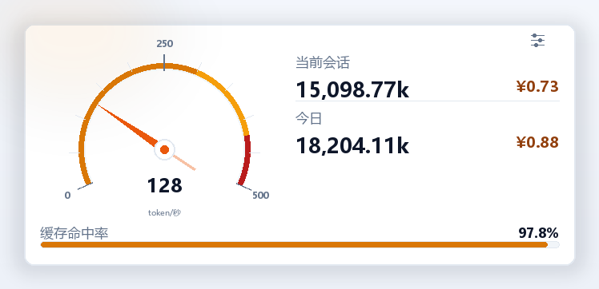
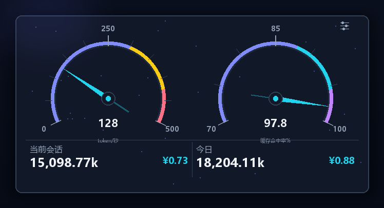
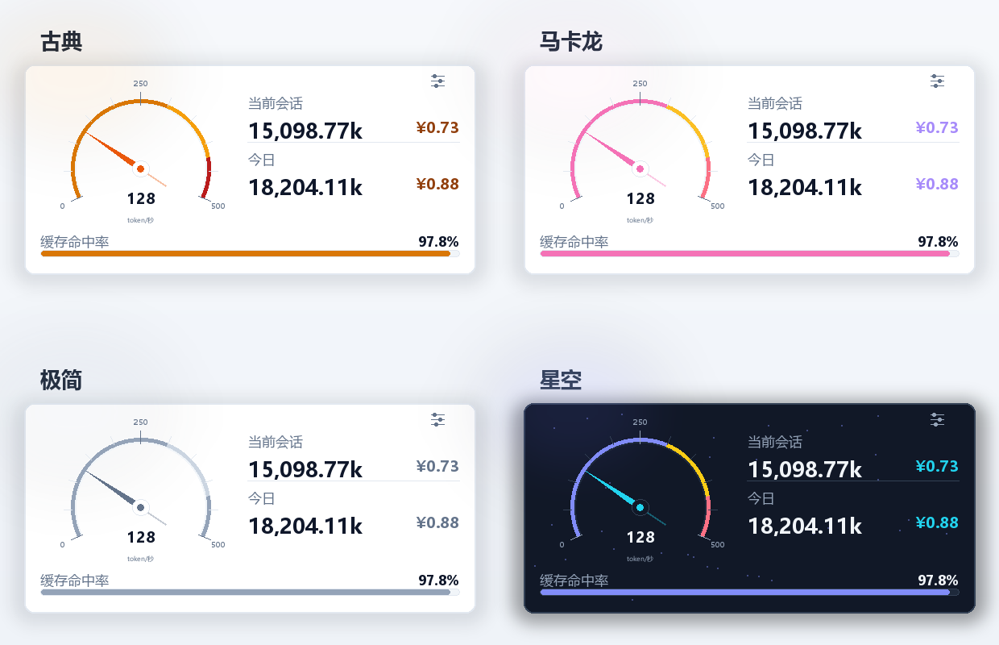
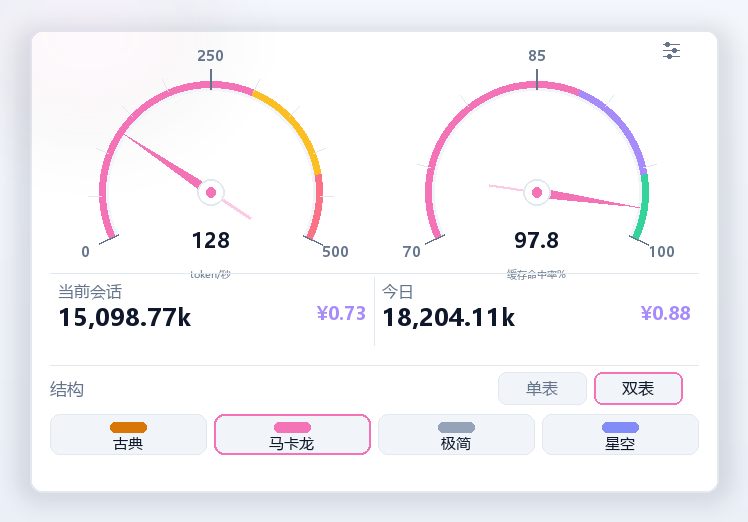

# dsh-token-gauge · 费用仪表盘

<p align="center">
  
  
</p>

<p align="center">
  
</p>

<p align="center">
  <a href="https://github.com/liumiaozhi/dsh-token-gauge/stargazers"></a>
  <a href="LICENSE"></a>
  
  
</p>

一个给 **DeepSeek Harness（DSH）** 用的侧边栏 Token 费用仪表盘。用老式车机 / 马卡龙 / 极简 / 星空四种皮肤，把 Token 输出速度、当前会话与今日消耗、缓存命中率做成一眼能读懂的仪表。

> 界面预览使用示例数据；实际数据来自 DSH 本地会话与计费插件聚合，不伪造样本。

## 特性

- **两种结构**
  - **单表**：左侧 Token 速度仪表盘，右侧当前会话 / 今日 Token 与金额，底部缓存命中率进度条。
  - **双表**：上方左侧 Token 速度、右侧缓存命中率两个仪表盘；下方并列展示当前会话与今日的 Token 量、金额。
- **四种皮肤**：古典（老式车机琥珀色）、马卡龙、极简、星空。结构 × 皮肤可自由组合，共 8 种呈现。
- **实时 Token 速度**：读取当前会话的流式输出增量，指针在 0–500 token/秒之间平滑摆动。
- **缓存命中率表盘**：量程 70–100%，刻度 70 / 85 / 100；低于 70% 时指针停在 70%，中央数字仍显示真实值。
- **Token 口径**：统一以 **k（千 token）** 显示，保留两位小数并带千分位，例如 `15,098.77k`。
- **设置入口**：卡片右上角滑杆图标；选择结构与皮肤后立即生效，并写入 `localStorage`，刷新后保留。
- **主题自适应**：颜色来自 DSH 主题令牌，深浅色模式均可读；不引入图表库、不请求外部 CDN。

## 安装

本插件复用 [@kenz1117/dsh-ui-usage-billing](https://github.com/kenz1117/dsh-ui-usage-billing) 的 Host 计费聚合接口 `/api/billing/usage-stats`。**请先安装计费插件**，否则仪表盘会显示 `--` / 0 值。

```bash
# 1. 数据来源：计费插件
dsh plugin --profile web add @kenz1117/dsh-ui-usage-billing

# 2. 本仪表盘
dsh plugin --profile web add dsh-token-gauge
```

从源码安装（本仓库）：

```bash
git clone https://github.com/liumiaozhi/dsh-token-gauge.git
dsh plugin --profile web add "link:<本仓库绝对路径>"
```

安装后重启或硬刷新 DSH Web，侧边栏底部原计费卡片位置会出现「费用仪表盘」。本插件以 slot 优先级覆盖原计费卡片，但保留计费插件的 Host 接口与其输入框费用胶囊。

## 使用

1. 点击卡片**右上角**的滑杆图标打开设置。
2. 在「结构」中选择 **单表 / 双表**。
3. 在下方四种皮肤中选择 **古典 / 马卡龙 / 极简 / 星空**。
4. 开始对话，Token 速度表会随流式输出更新；会话与今日数据每 1.5 秒刷新。

<p align="center">
  
</p>

## 数据与口径

| 指标 | 来源 / 口径 |
| --- | --- |
| Token 速度 | 当前会话 `assistant/live-chunk` 文本 / reasoning / tool-call 增量估算，0–500 token/秒 |
| 当前会话 Token | 当前会话所有轮次的 `input + output` |
| 今日 Token | 计费插件 `byDay` 中今天的 `input + output` |
| 当前会话金额 | `bySession.cost + subCost`（含子智能体） |
| 今日金额 | 计费插件按实时单价表估算的今日费用 |
| 缓存命中率 | 今日 `cacheHit / (cacheHit + cacheMiss)`，仪表盘量程 70–100% |

金额为计费插件按目录价 / 自定义单价估算的参考值，不是官方账单。

## 目录结构

```text
dsh-token-gauge/
├── package.json          # DSH bundle + Client 声明
├── cordis.patch.yml      # 插入 token-gauge 行
├── index.js              # Host 半边（空实现，仅承载 bundle）
├── client.js             # Client 半边：仪表盘 / 设置 / 样式
├── locale/
│   ├── zh.json           # 插件市场中文标题与描述
│   └── en.json
├── icon.svg              # 插件图标
├── screenshots/          # README 预览图
└── README.md / README.en.md / LICENSE
```

## 开发

```bash
git clone https://github.com/liumiaozhi/dsh-token-gauge.git
cd dsh-token-gauge
# 本插件是手写 Client bundle，无构建步骤
dsh plugin --profile web add "link:$PWD"
```

修改 `client.js` 后，DSH 的 Client HMR 会在文件变化后重新加载模块；没有热更新时刷新页面即可。

## 兼容与限制

- 面向 DSH Web（`platform: web`），需要 `@deepseek-ai/dsh-client-ui-sidebar` 与 `@deepseek-ai/dsh-client-ui-session`。
- 数据接口依赖 `@kenz1117/dsh-ui-usage-billing >= 1.7.0`；未安装时仪表盘仍会渲染，但数据为 `--`。
- 缓存命中率低于 70% 时指针停在 70% 刻度，中央数字保留真实值，避免表盘外推。
- README 图片为按实际组件样式生成的示例预览，数据为演示值。

## 许可

[MIT](LICENSE) © 2026 liumiaozhi
